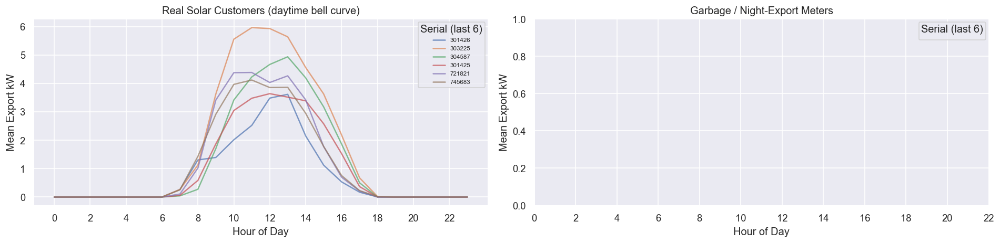
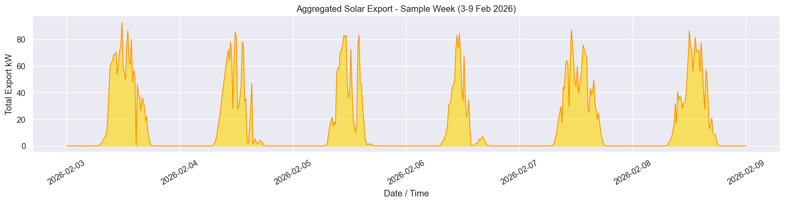
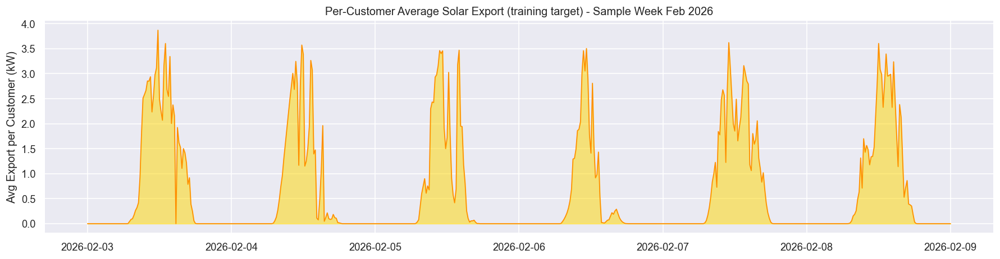
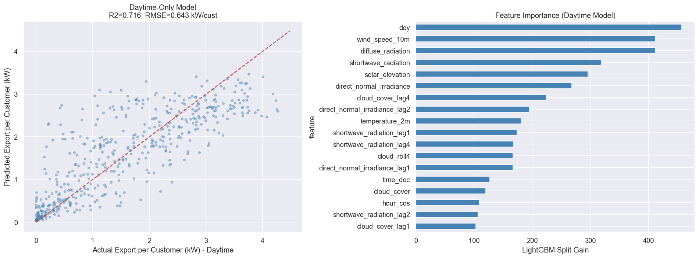
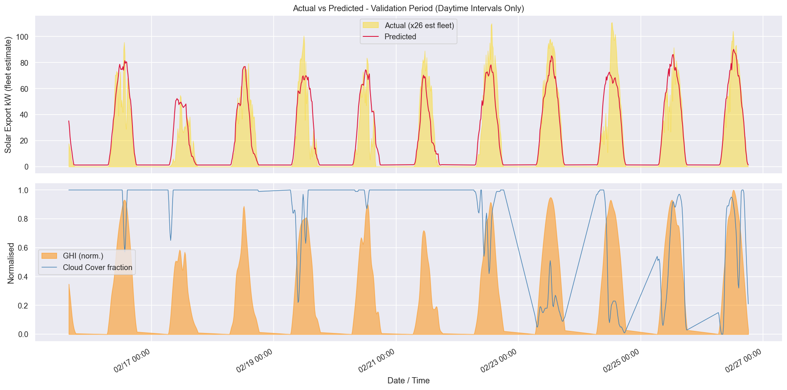

# SunShift - Solar Generation Forecasting Model (Retrained, Jan–Feb 2026)

**Project:** SunShift: Final-Year Software Engineering Project
**Location:** LECO Nawala Substation, Colombo, Sri Lanka (6.8895 °N, 79.8955 °E)
**Data period:** 1 Jan 2026 – 28 Feb 2026 (15-minute intervals)
**Model format:** ONNX opset 12 - ready for ML.NET consumption

---

## Why this retrain

The previous training set (`SunShift.ML`) contained **corrupted meter records**.
This directory retrains the identical pipeline on a freshly acquired,
corruption-free LECO export covering **January and February 2026**, supplied as
two monthly files:

- `LP-AZ0247-2026-01.csv`
- `LP-AZ0247-2026-02.csv`

Everything else — solar-customer identification, the 15-min resolution filter,
the per-customer target, daytime-only LightGBM with a log1p transform, the ONNX
contract, and the metadata schema — is unchanged from the original pipeline, so
the new model is a drop-in replacement for the ML.NET backend.

### Outcome vs. the previous model

| Metric | Previous (corrupted) | **This retrain (clean)** |
|---|---|---|
| Solar customers identified | 15 | **26** |
| Daytime val R² | −2.34 | **+0.716** |
| Daytime val RMSE | 0.315 kW/cust | 0.643 kW/cust |
| Daytime val MAE | 0.230 kW/cust | 0.457 kW/cust |
| Best iteration | 185 | 134 |

> The new R² is strongly positive (the old one was negative purely from a
> distribution mismatch in the old validation window). Absolute RMSE/MAE are
> larger because the clean dataset contains **26 genuine solar meters with real,
> higher-variance peak output** (peak per-customer export 4.47 kW vs the prior
> truncated data), rather than the artificially compressed range of the
> corrupted set. The model now actually tracks the solar bell-curve across
> sunny and cloudy days — see the validation time-series plot.

---

## Repository Structure

```
SunShift.ML2/
├── model_training.ipynb          # End-to-end ML pipeline (run top-to-bottom)
├── solar_forecast_model.onnx     # Trained model - ML.NET ready (opset 12)
├── model_metadata.json           # Feature order, tensor names, post-processing contract
├── requirements.txt              # Python dependencies
├── images/
│   ├── solar_fingerprint.png         # Solar vs garbage meter hourly profiles
│   ├── solar_aggregate_week.png      # Substation-level solar export - sample week
│   ├── solar_per_customer_week.png   # Per-customer training target - sample week
│   ├── model_evaluation_v2.png       # Daytime model scatter + feature importance
│   └── solar_forecast_timeseries.png # Actual vs predicted time-series (validation)
├── .gitignore
└── README.md
```

> **Files not tracked in git** (see `.gitignore`):
> - `LP-AZ0247-2026-*.csv` - LECO raw data (large / sensitive). Re-obtain from LECO / OUSL and place here before running the notebook.
> - `weather_nawala_15min.csv` - auto-generated by the notebook on first run from the Open-Meteo API; excluded to keep the repository lean.

---

## Data Pipeline

### 1. Load & concatenate the two monthly files

Both monthly CSVs share the same column schema as the original LECO export. They
are concatenated, parsed (note the **2-digit year** format `m/d/yy`), filtered to
`OBIS == 'LP'`, and **de-duplicated on `(serial, datetime)`** to remove any
overlap between the files.

**Result: 200,144 LP readings across 54 meters, 1 Jan – 28 Feb 2026.**

### 2. Solar Customer Identification

Genuine rooftop-solar meters export power only during daylight and show a
bell-shaped intra-day profile. Meters with > 8 % of non-zero export readings at
night are flagged as artefacts.

**Result: 26 real solar customers identified (0 night-export garbage meters in this clean set).**



### 3. 15-Min Resolution Filter & Per-Customer Target

Meters reporting only at daily resolution corrupt the aggregate. Only meters
with a **median reading interval ≤ 20 min** are kept (all 26 qualify here). The
target is the **per-customer average export** (`total_kW / n_reporting`), which
is invariant to meter communication gaps. Intervals with fewer than **3
reporting meters** are dropped.




### 4. Weather Features (Open-Meteo)

15-min weather is fetched from the Open-Meteo Historical Forecast API for the
Jan–Feb 2026 window and cached to `weather_nawala_15min.csv`.

| Feature | Description |
|---|---|
| `shortwave_radiation` | GHI (W/m²) - #1 predictor |
| `direct_normal_irradiance` | DNI (W/m²) |
| `diffuse_radiation` | DHI (W/m²) |
| `sunshine_duration` | Seconds of clear sun per 15-min block |
| `cloud_cover` | % (0–100) - inverse GHI proxy |
| `temperature_2m` | °C - PV efficiency penalty |
| `precipitation` | mm |
| `wind_speed_10m` | m/s - panel cooling |
| `is_day` | 0/1 - hard day/night gate |

Lag features (−15, −30, −60 min) and rolling means (1h, 2h windows) are derived
from GHI, DNI and cloud cover.

### 5. Feature Engineering - Full List (29 features)

| # | Feature | # | Feature |
|---|---|---|---|
| 0 | `shortwave_radiation` | 15 | `doy_sin` |
| 1 | `direct_normal_irradiance` | 16 | `doy_cos` |
| 2 | `diffuse_radiation` | 17 | `month_sin` |
| 3 | `sunshine_duration` | 18 | `month_cos` |
| 4 | `cloud_cover` | 19 | `shortwave_radiation_lag1` |
| 5 | `precipitation` | 20 | `shortwave_radiation_lag2` |
| 6 | `temperature_2m` | 21 | `shortwave_radiation_lag4` |
| 7 | `wind_speed_10m` | 22 | `direct_normal_irradiance_lag1` |
| 8 | `is_day` | 23 | `direct_normal_irradiance_lag2` |
| 9 | `solar_elevation` | 24 | `cloud_cover_lag1` |
| 10 | `time_dec` | 25 | `cloud_cover_lag4` |
| 11 | `doy` | 26 | `ghi_roll4` |
| 12 | `month` | 27 | `ghi_roll8` |
| 13 | `hour_sin` | 28 | `cloud_roll4` |
| 14 | `hour_cos` | | |

> **Order matters** - the ONNX input tensor must receive features in exactly this sequence.

---

## Model

### Algorithm: LightGBM Regressor

| Hyperparameter | Value |
|---|---|
| `objective` | `regression_l1` (MAE loss) |
| `n_estimators` | 3000 (early stopping at 134) |
| `learning_rate` | 0.03 |
| `num_leaves` | 47 |
| `max_depth` | 7 |
| `min_child_samples` | 15 |
| `subsample` | 0.8 |
| `colsample_bytree` | 0.8 |

### Training Strategy

- **Target:** `log1p(export_per_cust)` - compresses heavy tail from peak irradiance intervals
- **Scope:** Daytime-only intervals (`is_day == 1`)
- **Split:** Chronological 80/20 (no leakage)
  - Train: 2026-01-01 → 2026-02-15 (2,143 daytime rows)
  - Val:   2026-02-15 → 2026-02-26 (539 daytime rows)

### Validation Results

| Metric | Value |
|---|---|
| RMSE | 0.643 kW/customer |
| MAE | 0.457 kW/customer |
| R² | **0.716** |
| Fleet RMSE (×26) | 16.7 kW |
| Best iteration | 134 |




---

## ONNX Model Contract

| Property | Value |
|---|---|
| File | `solar_forecast_model.onnx` |
| Opset | 12 (`ai.onnx` 8 / `ai.onnx.ml` 1) |
| Input tensor | `float_input` - shape `[N, 29]`, dtype `float32` |
| Output tensor | `variable` - shape `[N, 1]`, dtype `float32` |
| Output meaning | `log1p(export_per_customer_kW)` |

This is identical to the original model's contract, so **no ML.NET code changes
are required** — replace the `.onnx` and `model_metadata.json` files and rebuild.

### Post-processing (must be applied by caller)

```
predicted_kW_per_customer = max(0, exp(raw_output) - 1)
predicted_fleet_kW        = predicted_kW_per_customer × 26
```

> **Note:** the per-customer multiplier for fleet-level estimates is now **26**
> (was 15). User-specific scaling (`SolarForecastScaler.ScaleToUserSystem`) is
> unchanged; the `fleet_avg_capacity_kwp` estimate is now **5.5 kWp** (from a
> peak per-customer export of 4.47 kW ÷ 0.82) — see `model_metadata.json`.

---

## ML.NET Integration (C#)

```csharp
var pipeline = mlContext.Transforms.ApplyOnnxModel(
    modelFile:         "solar_forecast_model.onnx",
    outputColumnNames: new[] { "variable" },
    inputColumnNames:  new[] { "float_input" });

var model  = pipeline.Fit(emptyDataView);
var engine = mlContext.Model.CreatePredictionEngine<SolarInput, SolarOutput>(model);

// float[29] in feature order from model_metadata.json
var input = new SolarInput { float_input = BuildFeatureVector(weatherNow, dateTimeNow) };

var raw      = engine.Predict(input).variable[0];
float fleetKw = Math.Max(0f, (float)(Math.Exp(raw) - 1f)) * 26;
```

The full user-specific scaling (panel capacity, tilt, azimuth, inverter clamp)
and POA-irradiance formulas are unchanged from the original `SunShift.ML`
README — refer to that document and `model_metadata.json → user_scaling`.

---

## Reproducing the Pipeline

### Requirements

- Python 3.10+
- Packages in `requirements.txt`: `lightgbm`, `onnx`, `onnxruntime`,
  `onnxmltools`, `skl2onnx`, `scikit-learn`, `pandas`, `numpy`, `matplotlib`,
  `seaborn`, `requests`

### Setup

```powershell
cd D:\SunShift\SunShift.ML2
python -m venv .venv
.\.venv\Scripts\Activate.ps1
pip install -r requirements.txt
```

> The sibling `SunShift.ML\.venv` already has every dependency and can be reused.

### Run

Open `model_training.ipynb` in VS Code, select the kernel, and run **Run All**.
The notebook is fully reproducible: weather is cached to
`weather_nawala_15min.csv` on first run; all artifacts (ONNX, metadata, images)
are written to this directory.

---

## Data Quality Notes

- **Clean dataset** — the prior `SunShift.ML` training data had corrupted records; this retrain uses corruption-free Jan + Feb 2026 exports.
- **26 of 54 meters** are genuine 15-min solar customers; the remainder are non-solar or non-exporting meters.
- **Per-customer target** is invariant to meter communication gaps (variable reporting counts per interval).
- Performance is expected to improve further with 6+ months of consistent smart-meter data.

---

## License

Academic / research use - OUSL Final Year Project 2026.
Raw LECO data subject to LECO data-sharing agreement; not redistributed here.
